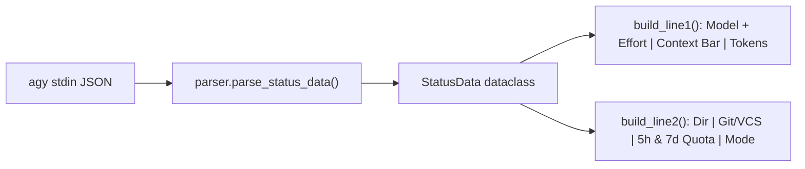

# Implementation Plan: `agy-cli-statusline-for-linux`

This plan adapts [claude-statusline-for-linux](https://github.com/ceshine/claude-statusline-for-linux/blob/main/README.md) into a Linux-first Python status line package for the Google Antigravity CLI (`agy`).

---

## 1. Architecture & Package Layout

Mirror the clean, zero-dependency architecture of `claude-statusline-for-linux`:

```text
agy-cli-statusline-for-linux/
├── .github/workflows/ci.yml
├── AGENTS.md
├── README.md
├── pyproject.toml
├── agy_statusline/
│   ├── __init__.py
│   ├── cli.py          # Entry point: reads stdin JSON, prints 2-line ANSI status
│   ├── constants.py    # Nerd Font icons (MD range), ANSI codes, BAR_SEGMENTS = 16
│   ├── models.py       # Dataclasses: CurrentUsage, RateLimitWindow, StatusData, Theme
│   ├── parser.py       # Parses agy stdin JSON payload into StatusData
│   ├── formatters.py   # Segment builders + build_line1() and build_line2()
│   └── theme.py        # Terminal theme detection (STATUSLINE_THEME / COLORFGBG)
└── tests/
    └── test_statusline.py
```

### Packaging (`pyproject.toml`)
- **Build backend:** `hatchling`
- **Python requirement:** `>=3.14` (and CI matrix testing `["3.14"]`)
- **Console script entry point:** `agy-statusline = "agy_statusline.cli:main"`
- **Runtime dependencies:** `[]` (stdlib only for fast `<300ms` execution)
- **Dev dependencies:** `pytest`, `ipython`

---

## 2. Two-Line Layout & Stdin JSON Mapping

- **Line 1:** `Model (+ Effort) │ Context Bar (16 segs) │ Tokens`
- **Line 2:** `Directory │ Git Branch & Status │ 5h usage │ 7d usage │ Vim / Mode`



| Feature | Antigravity CLI JSON (`agy_statusline`) | Handling in `agy_statusline` |
| :--- | :--- | :--- |
| **Model & Effort** | `model.display_name`, `model.id`, `model.effort` (`null` before selection) | Use `model.display_name` $\rightarrow$ fallback `model.id` $\rightarrow$ `"?"`. When `model.effort` is non-empty, display it alongside the model name (e.g., `󰚩 Gemini 4 Argon (medium)`). |
| **Directory** | `workspace.current_dir`, `cwd` | Check `workspace.current_dir` $\rightarrow$ fallback `cwd` $\rightarrow$ `"."`. |
| **Context %** | `context_window.used_percentage` | `float` (0–100), rendered with a 16-segment progress bar and `>=90%` red warning badge. |
| **Token Counts** | `context_window.current_usage` (nullable) + `total_input_tokens`, `total_output_tokens` | Parse `current_usage` (`input_tokens`, `output_tokens`, `cache_creation_input_tokens`, `cache_read_input_tokens`); fall back to `total_input_tokens` / `total_output_tokens` when `current_usage` is `null`. Only render `cw`/`cr` sub-fields when non-zero. |
| **Cost** | *(Removed)* | Cost estimation segment is omitted entirely from `models.py`, `parser.py`, and `build_line1()`. |
| **Quota (5h / 7d)** | `quota` map of bucket IDs $\rightarrow$ `{remaining_fraction, reset_time, reset_in_seconds, disabled}` | Select only the `5h` and `7d` buckets matching the active model, convert `remaining_fraction` $\rightarrow$ `used_pct = (1.0 - remaining_fraction) * 100`, and format countdown from `reset_in_seconds` or `reset_time`. |
| **Git / VCS** | `vcs: {type, branch, dirty}` + subprocess `git` | Keep detailed `git` subprocess check (`+staged ~unstaged ?untracked`). |
| **Vim / Mode** | `vim.mode` | Preserve optional `vim.mode` indicator at the end of Line 2. |

---

## 3. Active-Model Quota Bucket Selection

In `agy`, `quota` is a dictionary keyed by bucket ID:
- `gemini-5h` (5h window for Gemini models)
- `gemini-weekly` (7d window for Gemini models)
- `gemini-argon-wtu-weekly` (7d window for Gemini 4 Argon)
- `3p-5h` (5h window for third-party Claude / GPT models)
- `3p-weekly` (7d window for third-party Claude / GPT models)

### Selection Rules in `parser.py`
1. Inspect active model identifier (`(model.id or model.display_name).lower()`):
   - **Argon** (`"argon"` in model):
     - `five_hour`: `gemini-5h` (if present and not disabled)
     - `seven_day`: `gemini-argon-wtu-weekly` (fallback to `gemini-weekly` if absent/disabled)
   - **Gemini** (`"gemini"` in model):
     - `five_hour`: `gemini-5h`
     - `seven_day`: `gemini-weekly`
   - **Third-Party** (`"claude"` or `"gpt"` in model):
     - `five_hour`: `3p-5h`
     - `seven_day`: `3p-weekly`
   - **Fallback** (if `rate_limits.five_hour` / `rate_limits.seven_day` is provided or model family is unrecognized):
     - Check `gemini-5h` / `3p-5h` and `gemini-weekly` / `gemini-argon-wtu-weekly` / `3p-weekly` in order.
2. Ignore buckets with `"disabled": True` or `remaining_fraction is None`.
3. Compute `used_pct = (1.0 - float(remaining_fraction)) * 100.0`.
4. For reset timestamp:
   - Store `reset_in_seconds` (int) or `reset_time` (ISO string) on `RateLimitWindow`, so `usage_segment_str()` can compute the countdown either from `reset_in_seconds` directly or via `resets_at_to_epoch(reset_time) - now`.

---

## 4. Step-by-Step Execution Plan

1. **Project Configuration (`pyproject.toml`, `AGENTS.md`, `.github/workflows/ci.yml`)**
   - Update [pyproject.toml](./pyproject.toml) with `hatchling`, script entry point `agy-statusline = "agy_statusline.cli:main"`, `requires-python = ">=3.14"`, and dev dependencies (`pytest`, `ipython`).
   - Add `AGENTS.md` and `.github/workflows/ci.yml` targeting Python `3.14`.
2. **Core Modules (`agy_statusline/`)**
   - `constants.py`: Nerd Font icons (`ICON_MODEL`, `ICON_CTX`, `ICON_DIR`, `ICON_GIT`, `ICON_WARN`, `ICON_VIM`) and ANSI constants.
   - `models.py`: Dataclasses `CurrentUsage`, `RateLimitWindow`, `StatusData` (including `effort: str`, no `cost_usd`), and `Theme`.
   - `theme.py`: `detect_theme()`, `build_theme()`, and `pct_color()`.
   - `parser.py`: `parse_status_data()` parsing `agy` stdin payload and matching `quota` buckets to the active model.
   - `formatters.py`: `build_line1()` (Model + effort, context bar, token counts) and `build_line2()` (dir, git, 5h/7d quota, vim).
   - `cli.py`: `main()` reading `stdin` JSON and printing the two-line status.
3. **Unit Tests (`tests/test_statusline.py`)**
   - Comprehensive unit tests covering:
     - Active-model quota bucket matching (Gemini, Gemini 4 Argon, Claude/3P, disabled buckets, `remaining_fraction` $\rightarrow$ `used_pct`, `reset_in_seconds` and `reset_time`).
     - Model display name + `effort` formatting.
     - `context_window` and `current_usage` (with and without cache tokens, plus `total_input_tokens`/`total_output_tokens` fallback).
     - `git_info_str`, `build_line1`, `build_line2`, and `theme` helpers.
4. **Documentation (`README.md`)**
   - Document prerequisites (Python 3.14+, `uv`, `git`, Nerd Font) and setup via `~/.gemini/antigravity-cli/settings.json` and `/statusline`.
5. **Verification**
   - Run `uv sync`, `uv run pytest`, `uvx ruff check .`, and `uvx ruff format --check --line-length 120 .`.
